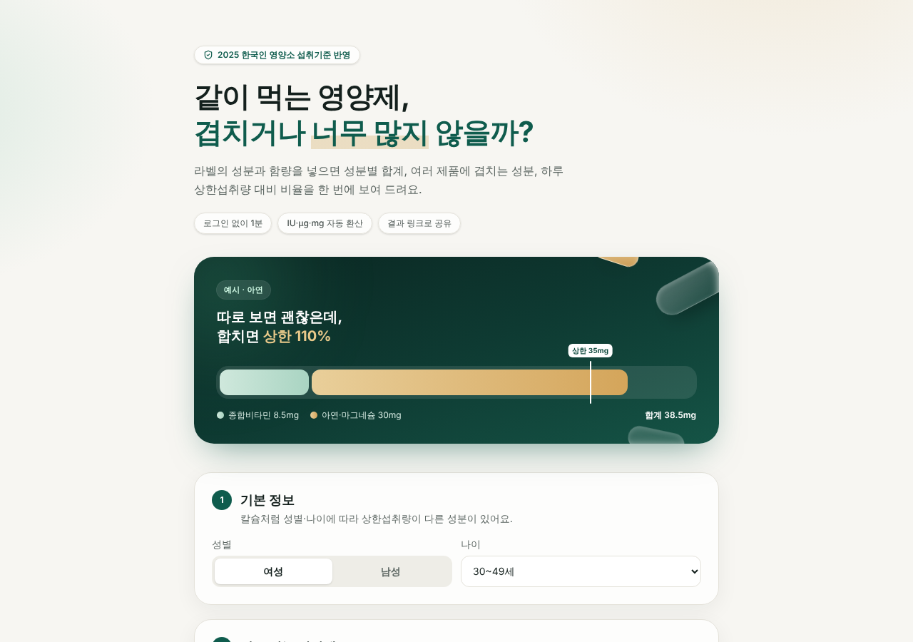

# 영양제 조합 체크

같이 먹는 영양제의 성분과 함량을 넣으면 **성분별 하루 합계, 여러 제품에 겹치는 성분, 하루 상한섭취량 대비 비율**을 한 화면에 보여 주는 웹 서비스입니다.

- 서비스 주소: (배포 후 추가)
- 기준: 보건복지부·한국영양학회, 「2025 한국인 영양소 섭취기준」 성인 19~64세 상한섭취량



## 왜 만들었나

종합비타민에 비타민D·아연이 들어 있는데 비타민D나 아연을 따로 또 먹는 경우가 흔합니다. 제품 하나씩 보면 문제가 없어 보여도 합치면 상한섭취량에 가깝거나 넘을 수 있습니다. 그런데 라벨은 제품마다 단위(IU, µg, mg)가 다르고, 상한섭취량은 성별·나이에 따라 달라서 직접 계산하기 번거롭습니다.

이 서비스는 그 계산 하나만 빠르게 해 줍니다. 진단이나 제품 추천은 하지 않습니다.

## 주요 기능

| 기능 | 설명 |
| --- | --- |
| 기본 정보 | 성별·나이(19~29 / 30~49 / 50~64세) 선택. 칼슘처럼 상한이 다른 성분에 반영 |
| 영양제 입력 | 제품 여러 개, 제품별 성분·함량·단위 입력. "예시로 채우기"로 바로 체험 |
| 단위 환산 | 비타민D IU ↔ µg, mg ↔ µg 등 성분별 기준 단위로 자동 환산 |
| 결과 요약 | 상한 넘음 / 상한 근접 / 겹치는 성분 개수를 맨 위에 표시 |
| 성분별 결과 | 합계, 상한 대비 비율(원형 게이지), 들어 있는 제품 목록, 성분별 참고 문구 |
| 결과 공유 | 입력 내용을 URL 해시에 담아 링크로 공유. 서버·DB 없이 링크만으로 결과 복원 |

### 판정 기준

- **상한 넘음**: 합계가 상한섭취량을 초과 (100% 초과)
- **상한 근접**: 상한섭취량의 80% 이상 100% 이하
- **안쪽**: 80% 미만
- 상한섭취량이 정해지지 않은 성분(비타민 B1·B2·B12 등)은 합계만 보여 줍니다.

## 측정 지표

Vercel Analytics로 방문과 아래 이벤트를 수집합니다. 개인 정보와 입력 내용은 보내지 않습니다.

| 이벤트 | 의미 |
| --- | --- |
| `example_loaded` | 예시로 체험을 시작함 |
| `supplement_added` | 영양제를 추가함 (실제 입력 의지) |
| `result_viewed` | 결과를 봄 (영양제 수·성분 수 함께 기록) |
| `share_clicked` | 결과 링크를 복사함 |
| `shared_link_opened` | 공유 링크로 들어옴 |

방문 → 결과 보기 → 공유 순서로 전환을 보고, 공유 링크 유입이 생기는지 확인하는 것이 1차 목표입니다.

## 기술 스택

- Next.js 15 (App Router), React 19, TypeScript
- Tailwind CSS v4, shadcn/ui 구조의 기본 컴포넌트(Button·Input·Card·Badge), lucide-react
- Vercel 배포, Vercel Analytics

## 구조

```
src/
  app/
    layout.tsx        메타 정보, 폰트, Analytics
    page.tsx
    globals.css       색상 토큰, 배경·애니메이션
  components/
    checker.tsx       입력 · 결과 · 공유 화면
    ui/               기본 컴포넌트
  data/nutrients.ts   성분 목록, 단위 환산 값, 상한섭취량 (출처 주석 포함)
  lib/calc.ts         합계 · 겹침 · 판정 계산
  lib/share.ts        결과 링크 인코딩 / 디코딩
```

계산 로직(`lib/calc.ts`)과 기준 데이터(`data/nutrients.ts`)를 화면과 분리해서, 기준값이 바뀌면 데이터 파일만 고치면 되도록 했습니다.

## 실행

```bash
npm install
npm run dev      # http://localhost:3000
npm run build    # 배포 전 빌드 확인
```

## 한계와 다음 단계

- 참고용 계산이며 의학적 조언이 아닙니다. 음식으로 먹는 양은 포함하지 않습니다.
- 임신·수유 중, 65세 이상, 19세 미만은 아직 지원하지 않습니다.
- 비타민 A는 µg RAE 단위만 받습니다.
- 일부 성분(비타민 E, 비타민 B6, 칼슘, 마그네슘)의 상한값은 섭취기준 원문 표와 한 번 더 대조하는 중입니다.
- 다음 후보: 제품명 검색(식품의약품안전처 건강기능식품 API), 연령 구간 확대
